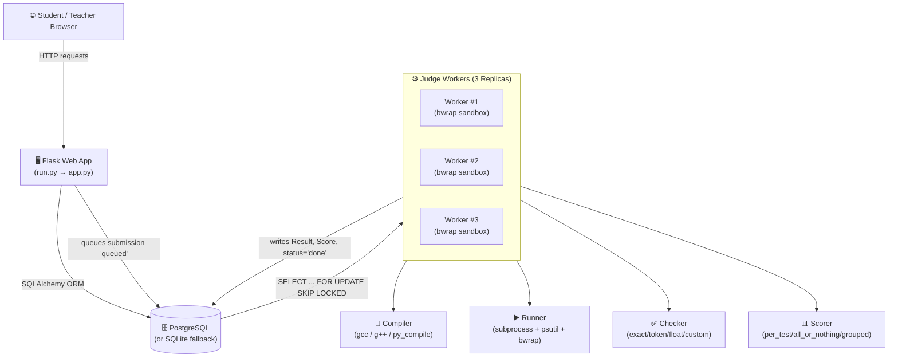
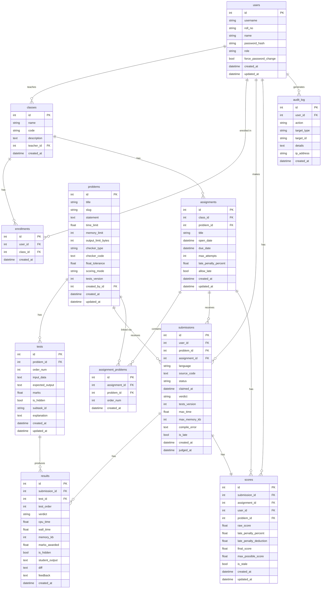
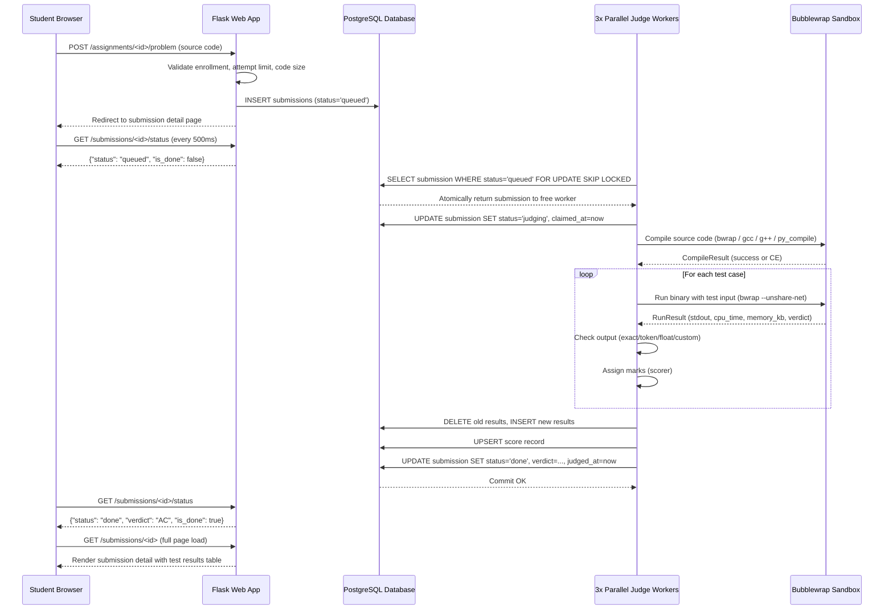

# CPJudge — Full Project Documentation

> **PUCIT Programming Fundamentals Lab Judge**
> A web-based, sandboxed automated judge system built for classroom and lab use at PUCIT.

---

## Table of Contents

1. [Project Overview](#1-project-overview)
2. [Technology Stack](#2-technology-stack)
3. [High-Level Architecture](#3-high-level-architecture)
4. [Project Structure](#4-project-structure)
5. [Database Design (ERD)](#5-database-design-erd)
   - [Tables & Columns](#51-tables--columns)
   - [Entity Relationship Diagram](#52-entity-relationship-diagram)
   - [Relationship Summary](#53-relationship-summary)
6. [Core Modules — Detailed Explanation](#6-core-modules--detailed-explanation)
   - [Application Factory (app.py)](#61-application-factory-apppy)
   - [Configuration (config.py)](#62-configuration-configpy)
   - [Database Models (models.py)](#63-database-models-modelspy)
   - [Auth Blueprint](#64-auth-blueprint)
   - [Teacher Blueprint](#65-teacher-blueprint)
   - [Student Blueprint](#66-student-blueprint)
   - [Judge Engine](#67-judge-engine)
7. [Judge Engine — Deep Dive](#7-judge-engine--deep-dive)
   - [compiler.py](#71-compilerpy)
   - [sandbox.py](#72-sandboxpy)
   - [docker_sandbox.py](#73-docker_sandboxpy)
   - [runner.py](#74-runnerpy)
   - [checker.py](#75-checkerpy)
   - [scorer.py](#76-scorerpy)
   - [verdicts.py](#77-verdictspy)
   - [judge.py (Orchestrator)](#78-judgepy-orchestrator)
   - [cli.py](#79-clipy)
8. [Web UI — Templates](#8-web-ui--templates)
9. [Utilities](#9-utilities)
10. [Configuration & Environment](#10-configuration--environment)
11. [Supported Verdicts](#11-supported-verdicts)
12. [Scoring System](#12-scoring-system)
13. [Sandbox & Security](#13-sandbox--security)
14. [API & Routes Reference](#14-api--routes-reference)
15. [Self-Tests & Testing Suite](#15-self-tests--testing-suite)
16. [Seed Data / Demo Setup](#16-seed-data--demo-setup)
17. [Deployment Guide (Docker)](#17-deployment-guide-docker)
18. [Data Flow — Submission Lifecycle](#18-data-flow--submission-lifecycle)

---

## 1. Project Overview

**CPJudge** is a full-stack programming judge designed for PUCIT's Programming Fundamentals lab. It allows:

- **Teachers** to create classes, problems (with test cases), and timed assignments.
- **Students** to view assigned problems, submit solutions in C, C++, or Python, and receive instant automated feedback.
- A **background worker** to compile, execute, and evaluate each submission in an isolated sandbox.
- **Automatic grading** with per-test scoring, late-penalty deductions, and a full audit trail.

### Key Features

| Feature | Details |
|---|---|
| Multi-language support | C (gcc -O2 -std=c11), C++ (g++ -O2 -std=c++17), Python 3 |
| Multiple sandbox backends | `bwrap` (Bubblewrap), `docker` containers, raw `process` mode |
| Flexible checkers | `exact`, `token` (whitespace-insensitive), `float` (tolerance), `custom` Python script |
| Scoring modes | `per_test`, `all_or_nothing`, `grouped` (subtask-based) |
| Hidden test cases | Hidden tests give marks but show no output/diff to students |
| Late submissions | Configurable late penalty (percentage deduction), optional allow/block |
| Bulk student import | CSV upload with auto-generated passwords |
| Test case ZIP upload | Batch upload of `.in` / `.ans` / `.out` pairs |
| Gradebook & CSV export | Per-class and per-assignment grade export |
| Audit logging | Every teacher action is logged with IP address and timestamp |
| Rate limiting | Flask-Limiter protects login (10/min) and submission (20/min) routes |
| CSRF protection | Flask-WTF on all state-changing forms |
| Timezone | All times stored in UTC, displayed in PKT (Asia/Karachi) |

---

## 2. Technology Stack

| Layer | Technology |
|---|---|
| **Web Framework** | Flask 3.0.3 |
| **ORM** | SQLAlchemy 2.0.35 / Flask-SQLAlchemy 3.1.1 |
| **Database** | PostgreSQL 16 (production Docker compose) or SQLite (fallback) |
| **Auth** | Flask-Login 0.6.3 |
| **Forms & CSRF** | Flask-WTF 1.2.1 |
| **Rate Limiting** | Flask-Limiter 3.8.0 |
| **Password Hashing** | argon2-cffi 23.1.0 (primary), bcrypt 4.2.0 |
| **Markdown Rendering** | markdown 3.7, bleach 6.1.0 (sanitization) |
| **Code Editor** | CodeMirror (bundled, offline) |
| **Frontend CSS/JS** | Bootstrap 5 + Bootstrap Icons (bundled, offline) |
| **Sandbox (Linux)** | Bubblewrap (bwrap) or Docker |
| **Sandbox (Docker)** | docker-py 7.1.0 |
| **Process Monitoring** | psutil 6.0.0 |
| **WSGI Server** | Gunicorn 22.0.0 (production) |
| **Testing** | pytest 8.3.3, pytest-timeout 2.3.1 |

---

## 3. High-Level Architecture



The web app and workers share the same database. Multiple workers run in parallel, using PostgreSQL's row-level `SKIP LOCKED` to atomically claim submissions with zero collisions.

---

## 4. Project Structure

```
PUCIT-PF-LAB-JUDGE-main/
│
├── run.py                        # WSGI entrypoint (Flask dev server or Gunicorn)
├── seed.py                       # Database seeder (demo data)
├── requirements.txt              # Python dependencies
├── .env                          # Environment variables (SECRET_KEY, DATABASE_URL, PORT)
├── .dockerignore
├── .gitignore
│
├── cpjudge/                      # Main application package
│   ├── __init__.py
│   ├── app.py                    # Flask application factory
│   ├── config.py                 # Config classes (Dev, Test, Prod, Worker)
│   ├── models.py                 # SQLAlchemy ORM models (all 10 tables)
│   │
│   ├── auth/                     # Authentication blueprint
│   │   ├── __init__.py           # Blueprint definition (auth_bp)
│   │   ├── decorators.py         # @teacher_required, @student_required, auth hooks
│   │   ├── forms.py              # LoginForm, ChangePasswordForm
│   │   └── routes.py             # /login, /logout, /change-password, /profile
│   │
│   ├── teacher/                  # Teacher blueprint
│   │   ├── __init__.py           # Blueprint definition (teacher_bp)
│   │   ├── forms.py              # ProblemForm, TestForm, ClassForm, AssignmentForm, etc.
│   │   └── routes.py             # All teacher CRUD routes (1446 lines)
│   │
│   ├── student/                  # Student blueprint
│   │   ├── __init__.py           # Blueprint definition (student_bp)
│   │   ├── forms.py              # CodeSubmissionForm
│   │   └── routes.py             # Dashboard, assignments, submission, history
│   │
│   ├── engine/                   # Judge engine (can be used as standalone library)
│   │   ├── __init__.py
│   │   ├── verdicts.py           # Verdict enum (AC, WA, TLE, MLE, RE, CE, OLE)
│   │   ├── compiler.py           # Compilation logic (C, C++, Python)
│   │   ├── sandbox.py            # Bubblewrap + POSIX rlimit sandboxing
│   │   ├── docker_sandbox.py     # Docker container-based sandboxing
│   │   ├── runner.py             # Process execution + resource monitoring
│   │   ├── checker.py            # Output comparison (exact/token/float/custom)
│   │   ├── scorer.py             # Scoring policies + late penalty
│   │   ├── judge.py              # Orchestrator: compile→run→check→score→persist
│   │   └── cli.py                # Standalone CLI for running judge from terminal
│   │
│   ├── utils/                    # Shared utilities
│   │   ├── __init__.py
│   │   ├── auth.py               # hash_password(), verify_password(), generate_random_password()
│   │   ├── backup.py             # SQLite backup/restore utility
│   │   ├── markdown.py           # render_markdown() with bleach sanitization
│   │   └── timezone.py           # PKT timezone helpers (now_pkt, format_pkt, to_pkt, utc_now)
│   │
│   ├── templates/                # Jinja2 HTML templates
│   │   ├── base.html             # Master layout (Bootstrap navbar, flash messages)
│   │   ├── auth/
│   │   │   ├── login.html
│   │   │   ├── change_password.html
│   │   │   └── profile.html
│   │   ├── student/
│   │   │   ├── dashboard.html
│   │   │   ├── assignments.html
│   │   │   ├── assignment_detail.html
│   │   │   ├── problem_view.html      # CodeMirror editor + submission form
│   │   │   ├── submission_detail.html # Live polling + test results
│   │   │   └── history.html
│   │   ├── teacher/
│   │   │   ├── dashboard.html
│   │   │   ├── problems.html
│   │   │   ├── problem_form.html
│   │   │   ├── problem_tests.html     # Test case management + ZIP upload
│   │   │   ├── test_form.html
│   │   │   ├── classes.html
│   │   │   ├── class_form.html
│   │   │   ├── class_detail.html      # Roster + import students
│   │   │   ├── class_gradebook.html
│   │   │   ├── assignments.html
│   │   │   ├── assignment_form.html
│   │   │   ├── assignment_gradebook.html
│   │   │   ├── submissions.html
│   │   │   ├── submission_detail.html
│   │   │   ├── student_import_result.html
│   │   │   └── audit_logs.html
│   │   └── errors/
│   │       ├── 403.html
│   │       ├── 404.html
│   │       └── 429.html
│   │
│   └── static/                   # Frontend assets (all bundled offline)
│       ├── css/
│       │   ├── bootstrap.min.css
│       │   ├── bootstrap-icons.min.css
│       │   └── fonts/
│       ├── js/
│       │   └── bootstrap.bundle.min.js
│       └── codemirror/
│           ├── codemirror.min.js
│           ├── codemirror.min.css
│           ├── dracula.min.css      # Dark theme for code editor
│           ├── clike.min.js         # C/C++ syntax highlighting
│           └── python.min.js        # Python syntax highlighting
│
├── tests/                        # pytest test suite
│   ├── __init__.py
│   ├── test_auth.py
│   ├── test_backup.py
│   ├── test_checker.py
│   ├── test_compiler.py
│   ├── test_docker_sandbox.py
│   ├── test_gradebook_and_rejudge.py
│   ├── test_models.py
│   ├── test_multi_problem_assignment.py
│   ├── test_scorer.py
│   ├── test_selftests.py
│   ├── test_student_ui.py
│   ├── test_teacher_ui.py
│   ├── test_timezone.py
│   └── test_worker.py
│
└── selftest/                     # Sample programs for engine self-testing
    ├── correct.c / correct.cpp / correct.py
    ├── wrong_answer.cpp / wrong_answer.py
    ├── infinite_loop.cpp / infinite_loop.py
    ├── fork_bomb.cpp
    ├── mle.cpp / mle.py
    ├── ole.cpp / ole.py
    ├── segfault.c / segfault.cpp
    ├── read_passwd.cpp            # Tests filesystem isolation
    ├── read_test_files.cpp
    └── sample_tests/
        ├── 1.in / 1.ans
        ├── 2.in / 2.ans
        └── 3_hidden.in / 3_hidden.ans
```

---

## 5. Database Design (ERD)

The database supports both **SQLite** (default, single file at `instance/cpjudge.db`) and **PostgreSQL** (via `DATABASE_URL` env var). All timestamps are stored in UTC.

### 5.1 Tables & Columns

#### `users`
Stores all user accounts (teachers and students).

| Column | Type | Constraints | Description |
|---|---|---|---|
| `id` | INTEGER | PK, autoincrement | Unique user ID |
| `username` | VARCHAR(64) | UNIQUE, NOT NULL, indexed | Login identifier |
| `roll_no` | VARCHAR(64) | UNIQUE, nullable, indexed | Student roll number (also valid login ID) |
| `name` | VARCHAR(128) | NOT NULL | Display name |
| `password_hash` | VARCHAR(255) | NOT NULL | Argon2 hashed password |
| `role` | VARCHAR(20) | NOT NULL, default='student' | `'teacher'` or `'student'` |
| `force_password_change` | BOOLEAN | NOT NULL, default=False | Forces password reset on next login |
| `created_at` | DATETIME(tz) | NOT NULL, default=utc_now | Account creation timestamp |
| `updated_at` | DATETIME(tz) | NOT NULL, onupdate=utc_now | Last modification timestamp |

---

#### `classes`
Academic classes/sections created by teachers.

| Column | Type | Constraints | Description |
|---|---|---|---|
| `id` | INTEGER | PK | Unique class ID |
| `name` | VARCHAR(128) | NOT NULL | Class full name |
| `code` | VARCHAR(32) | UNIQUE, NOT NULL, indexed | Short class code (e.g. `CS101-FA24`) |
| `description` | TEXT | nullable | Optional description |
| `teacher_id` | INTEGER | FK→users.id, CASCADE, indexed | Owning teacher |
| `created_at` | DATETIME(tz) | NOT NULL | Creation timestamp |

---

#### `enrollments`
Many-to-many mapping of students to classes.

| Column | Type | Constraints | Description |
|---|---|---|---|
| `id` | INTEGER | PK | Unique enrollment ID |
| `user_id` | INTEGER | FK→users.id, CASCADE, indexed | Student user |
| `class_id` | INTEGER | FK→classes.id, CASCADE, indexed | Class enrolled in |
| `created_at` | DATETIME(tz) | NOT NULL | Enrollment timestamp |

> **Unique constraint:** `(user_id, class_id)` — prevents duplicate enrollments.

---

#### `problems`
Programming problem definitions with limits and checker configuration.

| Column | Type | Constraints | Description |
|---|---|---|---|
| `id` | INTEGER | PK | Unique problem ID |
| `title` | VARCHAR(128) | NOT NULL | Problem title |
| `slug` | VARCHAR(128) | UNIQUE, NOT NULL, indexed | URL-safe identifier |
| `statement` | TEXT | NOT NULL | Problem statement (Markdown) |
| `time_limit` | FLOAT | NOT NULL, default=1.0 | CPU time limit in seconds |
| `memory_limit` | INTEGER | NOT NULL, default=256 | Memory limit in MB |
| `output_limit_bytes` | INTEGER | NOT NULL, default=10MB | Max output size in bytes |
| `checker_type` | VARCHAR(20) | NOT NULL, default='token' | `exact`, `token`, `float`, or `custom` |
| `checker_code` | TEXT | nullable | Custom checker Python source code |
| `float_tolerance` | FLOAT | NOT NULL, default=1e-6 | Tolerance for float checker |
| `scoring_mode` | VARCHAR(20) | NOT NULL, default='per_test' | `per_test`, `all_or_nothing`, `grouped` |
| `tests_version` | INTEGER | NOT NULL, default=1 | Incremented when test cases change (staleness detection) |
| `created_by_id` | INTEGER | FK→users.id, RESTRICT, indexed | Author (teacher) |
| `created_at` | DATETIME(tz) | NOT NULL | Creation timestamp |
| `updated_at` | DATETIME(tz) | NOT NULL, onupdate | Last update timestamp |

---

#### `tests`
Individual test cases for a problem.

| Column | Type | Constraints | Description |
|---|---|---|---|
| `id` | INTEGER | PK | Unique test case ID |
| `problem_id` | INTEGER | FK→problems.id, CASCADE, indexed | Parent problem |
| `order_num` | INTEGER | NOT NULL, default=1 | Display/execution ordering |
| `input_data` | TEXT | NOT NULL | stdin content for the test |
| `expected_output` | TEXT | NOT NULL | Expected stdout content |
| `marks` | FLOAT | NOT NULL, default=10.0 | Marks awarded for passing |
| `is_hidden` | BOOLEAN | NOT NULL, default=False | If True, output/diff is never shown to students |
| `subtask_id` | VARCHAR(64) | nullable | Used for grouped scoring mode |
| `explanation` | TEXT | nullable | Optional explanation shown for visible tests |
| `created_at` | DATETIME(tz) | NOT NULL | Creation timestamp |
| `updated_at` | DATETIME(tz) | NOT NULL, onupdate | Last update timestamp |

---

#### `assignments`
Assignments linking problems to classes with deadlines and submission rules.

| Column | Type | Constraints | Description |
|---|---|---|---|
| `id` | INTEGER | PK | Unique assignment ID |
| `class_id` | INTEGER | FK→classes.id, CASCADE, indexed | Target class |
| `problem_id` | INTEGER | FK→problems.id, SET NULL, nullable | Primary problem (legacy; prefer `assignment_problems`) |
| `title` | VARCHAR(128) | NOT NULL | Assignment title |
| `open_date` | DATETIME(tz) | NOT NULL | When students can start submitting |
| `due_date` | DATETIME(tz) | NOT NULL | Submission deadline |
| `max_attempts` | INTEGER | NOT NULL, default=0 | 0 = unlimited attempts per problem |
| `late_penalty_percent` | FLOAT | NOT NULL, default=0.0 | Percent deducted from late submissions |
| `allow_late` | BOOLEAN | NOT NULL, default=False | Whether late submissions are accepted |
| `created_at` | DATETIME(tz) | NOT NULL | Creation timestamp |
| `updated_at` | DATETIME(tz) | NOT NULL, onupdate | Last update timestamp |

---

#### `assignment_problems`
Junction table linking assignments to multiple problems in order.

| Column | Type | Constraints | Description |
|---|---|---|---|
| `id` | INTEGER | PK | Unique link ID |
| `assignment_id` | INTEGER | FK→assignments.id, CASCADE, indexed | Parent assignment |
| `problem_id` | INTEGER | FK→problems.id, CASCADE, indexed | Linked problem |
| `order_num` | INTEGER | NOT NULL, default=1 | Display order within assignment |
| `created_at` | DATETIME(tz) | NOT NULL | Creation timestamp |

> **Unique constraint:** `(assignment_id, problem_id)` — prevents duplicate problem links.

---

#### `submissions`
Student code submission records.

| Column | Type | Constraints | Description |
|---|---|---|---|
| `id` | INTEGER | PK | Unique submission ID |
| `user_id` | INTEGER | FK→users.id, CASCADE, indexed | Submitting student |
| `problem_id` | INTEGER | FK→problems.id, CASCADE, indexed | Target problem |
| `assignment_id` | INTEGER | FK→assignments.id, CASCADE, nullable | Assignment context |
| `language` | VARCHAR(20) | NOT NULL | `'c'`, `'cpp'`, or `'python'` |
| `source_code` | TEXT | NOT NULL | Student's source code |
| `status` | VARCHAR(20) | NOT NULL, default='queued', indexed | `queued`, `judging`, `done`, `error` |
| `claimed_at` | DATETIME(tz) | nullable | When the worker claimed this submission |
| `verdict` | VARCHAR(10) | nullable | `AC`, `WA`, `TLE`, `MLE`, `RE`, `CE`, `OLE` |
| `tests_version` | INTEGER | NOT NULL | Problem's `tests_version` at time of submission |
| `max_time` | FLOAT | nullable | Max CPU time across all test cases (seconds) |
| `max_memory_kb` | INTEGER | nullable | Peak memory across all test cases (KB) |
| `compile_error` | TEXT | nullable | Compiler error message if CE |
| `is_late` | BOOLEAN | NOT NULL, default=False | Was this submitted after the due date? |
| `created_at` | DATETIME(tz) | NOT NULL, indexed | Submission timestamp |
| `judged_at` | DATETIME(tz) | nullable | When judging completed |

---

#### `results`
Per-test execution results for a submission.

| Column | Type | Constraints | Description |
|---|---|---|---|
| `id` | INTEGER | PK | Unique result ID |
| `submission_id` | INTEGER | FK→submissions.id, CASCADE, indexed | Parent submission |
| `test_id` | INTEGER | FK→tests.id, SET NULL, nullable | The test case evaluated |
| `test_order` | INTEGER | NOT NULL | Execution order (1-based) |
| `verdict` | VARCHAR(10) | NOT NULL | `AC`, `WA`, `TLE`, `MLE`, `RE`, `CE`, `OLE` |
| `cpu_time` | FLOAT | NOT NULL, default=0.0 | CPU time used (seconds) |
| `wall_time` | FLOAT | NOT NULL, default=0.0 | Wall-clock time (seconds) |
| `memory_kb` | INTEGER | NOT NULL, default=0 | Peak memory used (KB) |
| `marks_awarded` | FLOAT | NOT NULL, default=0.0 | Marks given for this test |
| `is_hidden` | BOOLEAN | NOT NULL, default=False | Was this a hidden test? |
| `student_output` | TEXT | nullable | Student's stdout (NULL for hidden tests) |
| `diff` | TEXT | nullable | Unified diff (NULL for hidden tests) |
| `feedback` | TEXT | nullable | Checker feedback (NULL for hidden tests) |
| `created_at` | DATETIME(tz) | NOT NULL | Record creation timestamp |

> **Privacy rule:** `student_output`, `diff`, and `feedback` are **always NULL** for hidden tests.

---

#### `scores`
Calculated score summary for a submission.

| Column | Type | Constraints | Description |
|---|---|---|---|
| `id` | INTEGER | PK | Unique score ID |
| `submission_id` | INTEGER | FK→submissions.id, CASCADE, UNIQUE, indexed | One score per submission |
| `assignment_id` | INTEGER | FK→assignments.id, CASCADE, nullable | Assignment context |
| `user_id` | INTEGER | FK→users.id, CASCADE, indexed | Student |
| `problem_id` | INTEGER | FK→problems.id, CASCADE, indexed | Problem |
| `raw_score` | FLOAT | NOT NULL, default=0.0 | Total marks before penalty |
| `late_penalty_percent` | FLOAT | NOT NULL, default=0.0 | Penalty rate applied |
| `late_penalty_deduction` | FLOAT | NOT NULL, default=0.0 | Actual marks deducted |
| `final_score` | FLOAT | NOT NULL, default=0.0 | raw_score − deduction |
| `max_possible_score` | FLOAT | NOT NULL, default=0.0 | Total possible marks |
| `is_stale` | BOOLEAN | NOT NULL, default=False | True if problem tests changed after judging |
| `created_at` | DATETIME(tz) | NOT NULL | Creation timestamp |
| `updated_at` | DATETIME(tz) | NOT NULL, onupdate | Last update timestamp |

---

#### `audit_log`
Immutable log of all significant teacher/system actions.

| Column | Type | Constraints | Description |
|---|---|---|---|
| `id` | INTEGER | PK | Unique log entry ID |
| `user_id` | INTEGER | FK→users.id, SET NULL, nullable, indexed | Acting user (nullable if system) |
| `action` | VARCHAR(64) | NOT NULL, indexed | Action name (e.g. `create_problem`, `rejudge`) |
| `target_type` | VARCHAR(32) | nullable | Resource type: `problem`, `test`, `class`, `submission`, etc. |
| `target_id` | VARCHAR(64) | nullable | Resource ID as string |
| `details` | TEXT | nullable | JSON or free-text description |
| `ip_address` | VARCHAR(64) | nullable | Client IP address |
| `created_at` | DATETIME(tz) | NOT NULL, indexed | Log entry timestamp |

---

### 5.2 Entity Relationship Diagram



---

### 5.3 Relationship Summary

| Relationship | Type | Description |
|---|---|---|
| User → Classes | One-to-Many | A teacher creates many classes |
| User → Enrollments | One-to-Many | A student has many enrollments |
| Class → Enrollments | One-to-Many | A class has many enrolled students |
| Class → Assignments | One-to-Many | A class has many assignments |
| Problem → Tests | One-to-Many | A problem has many test cases (ordered) |
| Problem → Submissions | One-to-Many | A problem receives many submissions |
| Assignment → AssignmentProblem | One-to-Many | An assignment links to many problems |
| Problem → AssignmentProblem | One-to-Many | A problem can appear in many assignments |
| Submission → Results | One-to-Many | A submission produces one result per test |
| Submission → Score | One-to-One | A submission has exactly one score record |
| Test → Results | One-to-Many | A test case can appear in multiple submission results |

---

## 6. Core Modules — Detailed Explanation

### 6.1 Application Factory (`app.py`)

**File:** `cpjudge/app.py`

Implements the Flask application factory pattern via `create_app(config_name)`:

1. Loads the appropriate config class (`DevelopmentConfig`, `ProductionConfig`, etc.)
2. Validates production requirements (non-empty `SECRET_KEY`, valid sandbox backend)
3. Initializes Flask extensions: `SQLAlchemy`, `LoginManager`, `CSRFProtect`, `Limiter`
4. Registers three blueprints: `auth_bp`, `teacher_bp`, `student_bp`
5. Registers Jinja2 filters: `render_markdown`, `format_pkt`, `to_pkt`
6. Defines the root route `/` that redirects to the appropriate dashboard based on role
7. Registers error handlers for 403, 404, 429
8. Calls `_ensure_submission_claim_timestamp()` to safely add the `claimed_at` migration column to older databases

---

### 6.2 Configuration (`config.py`)

**File:** `cpjudge/config.py`

| Config Class | Used When | Key Settings |
|---|---|---|
| `DevelopmentConfig` | `FLASK_ENV=development` | `DEBUG=True`, SQLite at `instance/cpjudge.db` |
| `TestingConfig` | `FLASK_ENV=testing` | In-memory SQLite, CSRF disabled, rate limiting off, `SANDBOX_BACKEND=process` |
| `ProductionConfig` | `FLASK_ENV=production` | `DEBUG=False`, requires `SECRET_KEY` env var, enforces `bwrap` or `docker` sandbox |
| `WorkerConfig` | Judge worker process | `DEBUG=False`, generates random `SECRET_KEY` |

**Key config options:**

```
SECRET_KEY          - Flask session encryption key (must be set in .env for production)
DATABASE_URL        - Full PostgreSQL URL (optional; defaults to SQLite)
SANDBOX_BACKEND     - 'bwrap' | 'docker' | 'process'
SANDBOX_IMAGE       - Docker image for Docker backend (default: 'cpjudge:local')
USE_BWRAP           - Enable bubblewrap isolation (default: true)
SANDBOX_USER        - Low-privilege OS user for sandbox execution (default: 'judge_sandbox')
APP_TIMEZONE        - Timezone for display (default: 'Asia/Karachi')
MAX_CONTENT_LENGTH  - Max HTTP payload: 16 MB (for ZIP test uploads, CSV roster)
MAX_STUDENT_CODE_BYTES - Max source code size: 64 KB
RATELIMIT_DEFAULT   - '200 per day; 50 per hour'
```

---

### 6.3 Database Models (`models.py`)

**File:** `cpjudge/models.py`

Contains all 10 SQLAlchemy model classes. Key design decisions:

- **UTC everywhere:** All `DateTime` columns use `timezone=True`; default is always `utc_now()`.
- **`tests_version` staleness detection:** When tests are added, edited, or deleted, `problem.tests_version` is incremented. Submissions that were judged with an older version are marked stale automatically.
- **Privacy enforcement:** The `Result` model's `student_output`, `diff`, and `feedback` are always `None` for hidden tests at the ORM level (enforced in `judge.py`).
- **Cascade deletes:** Deleting a user cascades to enrollments, classes, submissions, and scores. Deleting a problem cascades to tests, submissions, and results.

**Notable model properties:**

| Model | Property | Description |
|---|---|---|
| `User` | `is_teacher`, `is_student` | Role check shortcuts |
| `Problem` | `total_marks` | Sum of all test marks |
| `Problem` | `visible_tests`, `hidden_tests` | Filtered test lists |
| `Assignment` | `is_active(now)` | True if currently open and within due date |
| `Assignment` | `is_late(timestamp)` | True if timestamp is after due date |
| `Assignment` | `problems` | Ordered list from `assignment_problems` or fallback `problem` |
| `Submission` | `is_stale` | True if problem's `tests_version` changed since judging |
| `Submission` | `has_current_score` | True if `done` and score is not stale |
| `Score` | `percentage` | `(final_score / max_possible_score) × 100` |
| `AuditLog` | `log(...)` | Class method to create and add an audit entry |

---

### 6.4 Auth Blueprint

**Files:** `cpjudge/auth/`

#### Routes

| Route | Method | Description |
|---|---|---|
| `/login` | GET, POST | Authenticates via username or roll_no (case-insensitive). Rate-limited: 10/min, 50/hr |
| `/logout` | GET, POST | Logs out and redirects to login |
| `/change-password` | GET, POST | Allows password change; clears `force_password_change` flag |
| `/profile` | GET | Fallback profile page |

#### Decorators (`decorators.py`)

- `@teacher_required` — Redirects non-teachers to 403
- `@student_required` — Redirects non-students to 403
- `ensure_submission_access(submission)` — Raises 403 if student tries to access another student's submission
- `register_auth_hooks(app)` — Before-request hook that enforces password change redirect for all pages

#### Security

- Failed logins are logged to `audit_log`
- Successful logins are logged to `audit_log`
- Open-redirect prevention: `is_safe_url()` validates `next` parameter strictly

---

### 6.5 Teacher Blueprint

**Files:** `cpjudge/teacher/routes.py` (1446 lines)

All routes require `@teacher_required`. Teachers can only access their own classes/problems (enforced with helper functions like `_teacher_problem_or_404`).

#### Route Groups

**Dashboard**
- `GET /dashboard` — Overview: total problems, classes, assignments, queued submissions, recent activity

**Problems CRUD**
- `GET /problems` — List teacher's problems
- `GET/POST /problems/new` — Create new problem
- `GET/POST /problems/<id>/edit` — Edit problem
- `POST /problems/<id>/delete` — Delete problem + cascaded tests

**Test Cases**
- `GET/POST /problems/<id>/tests` — View/add test cases (manual form + ZIP upload)
- `GET/POST /problems/<id>/tests/<test_id>/edit` — Edit a test case
- `POST /problems/<id>/tests/<test_id>/delete` — Delete a test case
- `POST /problems/<id>/tests/upload-zip` — Bulk-import tests from ZIP archive

**ZIP Upload Logic:**
- Max 1000 entries, max 8 MB per file, max 64 MB total uncompressed
- Pairs `.in` files with `.ans` or `.out` files by stem name
- Visibility set by: form mode (`all_visible` / `all_hidden`) or auto-detect (`hidden` in stem)
- Path traversal protection (strips `..`, absolute paths, backslashes)

**Classes**
- `GET /classes` — List teacher's classes
- `GET/POST /classes/new` — Create class
- `GET /classes/<id>` — View class (roster + assignments)
- `GET/POST /classes/<id>/edit` — Edit class
- `POST /classes/<id>/delete` — Delete class
- `GET/POST /classes/<id>/import-students` — Bulk-import students from CSV

**CSV Student Import Logic:**
- Accepts CSV file or pasted CSV text
- Auto-detects header row (`roll`, `name` column names)
- Creates new User accounts with auto-generated 10-character passwords
- Sets `force_password_change=True` on all new accounts
- Skips already-enrolled students
- Returns credential table (download before leaving page)

**Assignments**
- `GET /assignments` — List all assignments
- `GET/POST /assignments/new` — Create assignment (supports multi-problem)
- `GET/POST /assignments/<id>/edit` — Edit assignment
- `POST /assignments/<id>/delete` — Delete assignment
- `GET /assignments/<id>` — Assignment detail view
- `GET /assignments/<id>/gradebook` — Per-student grade summary table
- `GET /assignments/<id>/gradebook/export` — Export gradebook as CSV

**Submissions (Teacher View)**
- `GET /submissions` — View all submissions for teacher's problems
- `GET /submissions/<id>` — View detailed submission including hidden test results
- `POST /submissions/<id>/rejudge` — Re-queue a submission for re-evaluation
- `POST /assignments/<id>/rejudge-all` — Re-queue all submissions for an assignment

**Gradebook & Reports**
- `GET /classes/<id>/gradebook` — Class-wide gradebook (all assignments)
- `GET /classes/<id>/gradebook/export` — Export class grades as CSV
- `GET /audit-logs` — View audit log entries

---

### 6.6 Student Blueprint

**Files:** `cpjudge/student/routes.py`

All routes require `@student_required`.

| Route | Method | Description |
|---|---|---|
| `/dashboard` | GET | Shows enrolled classes, upcoming assignments, recent submissions |
| `/assignments` | GET | Lists all assignments with best scores and attempt counts |
| `/assignments/<id>` | GET | Assignment detail with per-problem progress |
| `/assignments/<id>/problem` | GET, POST | View problem statement and submit solution |
| `/assignments/<id>/problems/<pid>` | GET, POST | Same, for specific problem in multi-problem assignment |
| `/submissions/<id>` | GET | Submission detail with test results (hidden test outputs masked) |
| `/submissions/<id>/status` | GET | JSON polling endpoint (called every 500ms by browser) |
| `/history` | GET | Full submission history with filters (problem, assignment, verdict) |

#### Submission Flow

1. Student opens assignment problem page (CodeMirror editor)
2. Pastes/types code or uploads a source file (`.c`, `.cpp`, `.py`)
3. System validates: enrollment, assignment window, attempt limit, code size (≤64 KB)
4. `Submission` record created with `status='queued'`
5. Student redirected to submission detail page with live 2-second polling
6. Worker picks up the submission, judges it, updates status to `done` or `error`
7. Browser detects `is_done=true` from polling endpoint and reloads the page

---

### 6.7 Judge Engine

**Package:** `cpjudge/engine/`

The engine is a fully independent library. It can be used:
- By the **web worker** via `judge()` (database-integrated)
- Standalone via `judge_submission()` (pure in-memory)
- From the **command line** via `cli.py`

---

## 7. Judge Engine — Deep Dive

### 7.1 `compiler.py`

Compiles or syntax-checks student source code.

| Language | Command | Notes |
|---|---|---|
| C | `gcc -O2 -std=c11 solution.c -o solution.out -lm` | Produces binary |
| C++ | `g++ -O2 -std=c++17 solution.cpp -o solution.out -lm` | Produces binary |
| Python | `py_compile.compile()` | Syntax-only check; produces run command `python solution.py` |

**Sandbox support:** Compilation can optionally run inside `bwrap` or `docker` for isolation.

**Compile timeout:** Configurable (default: 10s). Returns `CompileResult` with:
- `success: bool`
- `run_cmd: List[str]` — The command to execute
- `executable_path: str` — Path to binary/script
- `error_message: str` — Compiler error output
- `compile_time: float` — Elapsed compilation time

---

### 7.2 `sandbox.py`

POSIX-based sandboxing using Linux resource limits and Bubblewrap.

**Resource limits set via `preexec_fn` (before process exec):**

| Limit | Resource | Value |
|---|---|---|
| CPU time | `RLIMIT_CPU` | `ceil(cpu_limit)` seconds (soft), +1 (hard) |
| Memory | `RLIMIT_AS` | Virtual address space in bytes |
| Output | `RLIMIT_FSIZE` | Max file size in bytes |
| Processes | `RLIMIT_NPROC` | Max process/thread count |
| Core dumps | `RLIMIT_CORE` | 0 (disabled) |

**Bubblewrap (`bwrap`) isolation:**
- `--unshare-net` — No network access
- `--unshare-pid` — Isolated PID namespace
- `--unshare-ipc` — Isolated IPC namespace
- `--unshare-uts` — Isolated hostname namespace
- `--die-with-parent` — Child dies if parent exits
- `--ro-bind` — Read-only bind mounts of `/usr`, `/bin`, `/lib`
- `--bind` — Read-write bind of work directory only
- Runs as low-privilege `judge_sandbox` user (UID/GID looked up via `pwd`)

**`build_child_environment()`** returns a minimal safe environment:
```python
{
    "PATH": os.defpath,
    "HOME": "/tmp",
    "TMPDIR": "/tmp",
    "LANG": "C.UTF-8",
    "LC_ALL": "C.UTF-8",
    "PYTHONIOENCODING": "utf-8",
}
```

---

### 7.3 `docker_sandbox.py`

Runs commands in a **disposable Docker container** for maximum isolation.

**Container configuration:**
- `network_mode="none"` — No network
- `read_only=True` — Immutable filesystem (except `/tmp` and `/work`)
- `cap_drop=["ALL"]` — All Linux capabilities removed
- `security_opt=["no-new-privileges:true"]` — Cannot elevate privileges
- `user="10001:10001"` — Non-root low-privilege user
- `mem_limit` / `memswap_limit` — Hard memory cap
- `pids_limit` — Max process count
- `tmpfs=/tmp` — Ephemeral temp storage

**Execution workflow:**
1. Create a tmpfs Docker volume (`/work`)
2. Stage files into `/work` via a staging container (using `put_archive`)
3. Create execution container with the wrapped command (via `prlimit` + `/usr/bin/time`)
4. Poll container state every 25ms, check CPU usage from Docker stats
5. Kill container if wall_timeout or cpu_limit exceeded
6. Read stdout, stderr, metrics, and artifacts from container filesystem
7. Clean up container and volume

**Output files written inside container:**
- `/work/.cpjudge_stdout` — Program output
- `/work/.cpjudge_stderr` — Error output
- `/work/.cpjudge_metrics` — CPU user+sys+memory from `/usr/bin/time`
- `/work/.cpjudge_exit` — Exit code
- `/work/.cpjudge_stdin` — Input piped to program

---

### 7.4 `runner.py`

Executes student code against a single test case and measures resource usage.

**Key behaviors:**
- Python submissions get a 3× time multiplier (default) vs C/C++
- Wall timeout = `max(2.5, cpu_limit × 2.5 + 1.0)` seconds
- Copies binary/script to a fresh temp directory for isolation
- Uses three threads: `stdout_drain`, `stderr_drain`, `input_writer`
- Uses a resource monitoring thread (polls every 10ms) via `psutil`
- Monitors all child processes recursively (fork bomb protection)
- Kills entire process group (`SIGKILL` to `pgid`) on timeout

**Verdict determination logic (in order of priority):**

| Priority | Condition | Verdict |
|---|---|---|
| 1 | Output length > limit or SIGXFSZ | OLE |
| 2 | Wall timeout or CPU limit exceeded | TLE |
| 3 | SIGXCPU / SIGPROF / cpu_time ≥ limit | TLE |
| 4 | OOM error message in stderr | MLE |
| 5 | SIGSEGV/SIGABRT/SIGBUS near memory limit | MLE |
| 6 | Memory exceeded and non-zero exit | MLE |
| 7 | Non-zero exit code | RE |
| 8 | Exit code 0 | (None — checker decides AC/WA) |

---

### 7.5 `checker.py`

Compares student output to expected output.

| Checker | Mode | Description |
|---|---|---|
| `exact` | String match | Normalizes line endings (CRLF→LF), strips trailing whitespace |
| `token` | Token match | Splits on whitespace, compares token-by-token |
| `float` | Float match | Token comparison with `math.isclose(rel_tol, abs_tol)` |
| `custom` | Script | Runs teacher-provided Python script with args: `(input_file, expected_file, actual_file)`. Exit 0 = AC, non-zero = WA |

For **visible tests** where verdict is WA, `generate_diff()` creates a unified diff (up to 100 lines) stored in `Result.diff`.

For **hidden tests**, `diff` is always `None` regardless of verdict.

---

### 7.6 `scorer.py`

Calculates marks from test results.

| Scoring Mode | Behavior |
|---|---|
| `per_test` | Each test awarded its own marks independently |
| `all_or_nothing` | Full marks only if ALL tests pass; otherwise 0 |
| `grouped` | Tests grouped by `subtask_id`; a subtask scores only if all its tests pass |

**Late penalty:**
```
deduction = raw_score × (late_penalty_percent / 100)
final_score = max(0.0, raw_score − deduction)
```

Returns `ScoreResult` with `raw_score`, `final_score`, `max_score`, `late_penalty_deduction`, `test_marks_awarded` (dict), `subtask_marks_awarded` (dict).

---

### 7.7 `verdicts.py`

```python
class Verdict(str, Enum):
    AC  = "AC"   # Accepted — all tests passed
    WA  = "WA"   # Wrong Answer — output does not match
    TLE = "TLE"  # Time Limit Exceeded
    MLE = "MLE"  # Memory Limit Exceeded
    RE  = "RE"   # Runtime Error — non-zero exit
    CE  = "CE"   # Compilation Error
    OLE = "OLE"  # Output Limit Exceeded
```

---

### 7.8 `judge.py` (Orchestrator)

Provides two functions:

#### `judge_submission(source_code, language, test_cases, config) → SubmissionResult`

Pure in-memory judge. Steps:
1. **Compile** source code in a temp directory
2. For each test case:
   - **Run** the compiled binary with test input
   - If execution fails → record `verdict` (TLE/MLE/RE/OLE)
   - If execution succeeds → **check** output with configured checker
3. **Score** all test results with configured scoring mode
4. Return `SubmissionResult` with overall verdict, scores, per-test details

#### `judge(submission_id) → SubmissionResult`

Database-integrated judge. Steps:
1. Load `Submission` from DB, fetch `Problem` and all `Test` records
2. Set `submission.tests_version` to current `problem.tests_version`
3. Build `JudgeConfig` from problem and app settings
4. Call `judge_submission()`
5. Clear old `Result` records (supports rejudging)
6. Create new `Result` records (strict: hidden test fields → NULL)
7. Upsert `Score` record
8. Update `Submission.status`, `verdict`, `max_time`, `max_memory_kb`, `judged_at`
9. Commit; on error → rollback, set `status='error'`

---

### 7.9 `cli.py`

Standalone CLI for running the judge without the web interface.

```bash
python -m cpjudge.engine.cli \
  --source solution.py \
  --lang python \
  --tests-dir ./sample_tests \
  --time-limit 1.0 \
  --memory-limit 256 \
  --checker token \
  --scoring per_test \
  --json
```

Supports human-readable and JSON output. Useful for local testing before deploying to the web platform.

---

## 8. Web UI — Templates

All templates extend `base.html` which provides:
- Bootstrap 5 responsive navigation bar
- Flash message display (success, danger, warning, info)
- PKT timezone label
- Bootstrap Icons

### Student Pages

| Template | Purpose |
|---|---|
| `student/dashboard.html` | Enrolled classes, upcoming assignments, recent submissions |
| `student/assignments.html` | Assignment list with attempt counts and best scores |
| `student/assignment_detail.html` | Per-problem progress within an assignment |
| `student/problem_view.html` | Problem statement (Markdown-rendered) + CodeMirror editor with file upload |
| `student/submission_detail.html` | Test results table, diff viewer, live JS polling (every 500ms) |
| `student/history.html` | Full submission history with filter dropdowns |

### Teacher Pages

| Template | Purpose |
|---|---|
| `teacher/dashboard.html` | Metrics overview + recent submissions + audit log |
| `teacher/problems.html` | Problem library list |
| `teacher/problem_form.html` | Create/edit problem form |
| `teacher/problem_tests.html` | Test case management + manual add + ZIP upload |
| `teacher/test_form.html` | Edit individual test case |
| `teacher/classes.html` | Class list |
| `teacher/class_form.html` | Create/edit class |
| `teacher/class_detail.html` | Roster, enrollments, assignments, import students |
| `teacher/class_gradebook.html` | All-student, all-assignment grade table |
| `teacher/assignment_form.html` | Create/edit assignment with multi-problem selection |
| `teacher/assignment_gradebook.html` | Per-student scores for a single assignment |
| `teacher/submissions.html` | All submissions (with filtering) |
| `teacher/submission_detail.html` | Full submission details including hidden test results |
| `teacher/student_import_result.html` | Credential table after CSV import |
| `teacher/audit_logs.html` | Audit log browser |

---

## 9. Utilities

### `utils/auth.py`
- `hash_password(password)` — Argon2 hashing (bcrypt as fallback)
- `verify_password(password, hash)` — Verifies against Argon2 or bcrypt hash
- `generate_random_password(length)` — Generates a random alphanumeric password for auto-import

### `utils/timezone.py`
- `utc_now()` — Returns current UTC datetime (timezone-aware)
- `now_pkt()` — Returns current PKT time
- `to_pkt(dt)` — Converts any datetime to PKT
- `format_pkt(dt, fmt)` — Formats a datetime in PKT timezone
- `ensure_utc(dt)` — Ensures datetime is UTC-aware
- `ensure_pkt(dt)` — Ensures datetime is PKT-aware

### `utils/markdown.py`
- `render_markdown(text)` — Renders Markdown to sanitized HTML
  - Uses `markdown` library with `fenced_code`, `tables`, `attr_list` extensions
  - Sanitizes output with `bleach` to prevent XSS
  - Allows `<pre>`, `<code>`, `<table>`, `<th>`, `<tr>`, `<td>`, `<strong>`, `<em>`, `<a>` etc.

### `utils/backup.py`
- SQLite backup and restore utility
- Run with: `python -m cpjudge.utils.backup --backup`
- Safe online backup (SQLite WAL-compatible)

---

## 10. Configuration & Environment

The `.env` file at the project root configures the runtime:

```ini
SECRET_KEY=59d24810d67a220525d26485f92768fc6d9a0adbaf6914d73faf151989d2f72f   # Required session secret
POSTGRES_PASSWORD=cpjudge_secure_db_pass_2026                                   # Required for PostgreSQL
SANDBOX_BACKEND=bwrap                                                           # 'bwrap' (fast, default) | 'docker' | 'process'
PORT=5050                                                                       # Host port for web service (default: 5050)
APP_TIMEZONE=Asia/Karachi                                                       # Display timezone (default: Asia/Karachi)
```

The database URL is automatically composed in `docker-compose.yml`:
`postgresql://cpjudge:${POSTGRES_PASSWORD}@db/cpjudge`
If running without Docker, omitting `DATABASE_URL` safely falls back to local SQLite at `instance/cpjudge.db`.

---

## 11. Supported Verdicts

| Code | Full Name | Meaning |
|---|---|---|
| `AC` | Accepted | All test cases passed correctly |
| `WA` | Wrong Answer | Output doesn't match expected (visible test diff shown) |
| `TLE` | Time Limit Exceeded | CPU or wall time limit exceeded |
| `MLE` | Memory Limit Exceeded | Virtual memory / RSS limit exceeded |
| `RE` | Runtime Error | Process exited with non-zero exit code (segfault, exception, etc.) |
| `CE` | Compilation Error | Code failed to compile / syntax check |
| `OLE` | Output Limit Exceeded | Student printed more than the allowed output |

---

## 12. Scoring System

### Per-Test (default)

```
score = sum(marks for test if verdict == AC)
```

### All-or-Nothing

```
score = total_marks if ALL tests are AC else 0
```

### Grouped (Subtask)

```
for each subtask:
    if ALL tests in subtask are AC:
        score += subtask_weight
    else:
        score += 0
```

### Late Penalty

```
deduction = raw_score × (late_penalty_percent / 100.0)
final_score = max(0.0, raw_score − deduction)
```

---

## 13. Sandbox & Security

### Three Backends

| Backend | Isolation | Use Case |
|---|---|---|
| `process` | POSIX rlimits only | Development / Windows (no bwrap/docker) |
| `bwrap` | Namespaces + rlimits | Linux production (requires bubblewrap) |
| `docker` | Full container isolation | Docker production (most secure) |

### Security Measures

- **No network:** Docker `network_mode=none` or bwrap `--unshare-net`
- **No root:** Runs as UID 10001 / `judge_sandbox`
- **No new privileges:** Docker `no-new-privileges:true`
- **Filesystem isolation:** Read-only root, only `/work` and `/tmp` are writable
- **Capability drop:** `cap_drop=ALL` in Docker
- **Fork bomb protection:** `RLIMIT_NPROC`, process group kill, recursive psutil monitoring
- **Output limit:** `RLIMIT_FSIZE` + application-level truncation
- **Compilation isolation:** Compiler also runs in sandbox (optional)
- **Hidden test privacy:** Outputs/diffs never stored for hidden tests at model level
- **CSRF:** All forms are CSRF-protected via Flask-WTF
- **Rate limiting:** Login (10/min), submissions (20/min)
- **Open-redirect prevention:** `is_safe_url()` validation on `next` param
- **Formula injection prevention:** CSV export prefixes dangerous cells with `'`
- **ZIP path traversal:** Strips `..`, absolute paths, and backslashes from ZIP entries

---

## 14. API & Routes Reference

### Auth Routes (`/`)

| Method | URL | Auth | Description |
|---|---|---|---|
| GET/POST | `/login` | Public | Login page |
| GET/POST | `/logout` | Logged in | Logout |
| GET/POST | `/change-password` | Logged in | Change password |
| GET | `/profile` | Logged in | Profile page |

### Teacher Routes (`/teacher/` prefix implied)

| Method | URL | Description |
|---|---|---|
| GET | `/dashboard` | Teacher dashboard |
| GET | `/problems` | Problem list |
| GET/POST | `/problems/new` | Create problem |
| GET/POST | `/problems/<id>/edit` | Edit problem |
| POST | `/problems/<id>/delete` | Delete problem |
| GET/POST | `/problems/<id>/tests` | Manage test cases |
| GET/POST | `/problems/<id>/tests/<tid>/edit` | Edit test case |
| POST | `/problems/<id>/tests/<tid>/delete` | Delete test case |
| POST | `/problems/<id>/tests/upload-zip` | Bulk import via ZIP |
| GET | `/classes` | Class list |
| GET/POST | `/classes/new` | Create class |
| GET | `/classes/<id>` | Class detail |
| GET/POST | `/classes/<id>/edit` | Edit class |
| POST | `/classes/<id>/delete` | Delete class |
| GET/POST | `/classes/<id>/import-students` | CSV student import |
| GET | `/classes/<id>/gradebook` | Class gradebook |
| GET | `/classes/<id>/gradebook/export` | Export grades as CSV |
| GET | `/assignments` | Assignment list |
| GET/POST | `/assignments/new` | Create assignment |
| GET/POST | `/assignments/<id>/edit` | Edit assignment |
| POST | `/assignments/<id>/delete` | Delete assignment |
| GET | `/assignments/<id>` | Assignment detail |
| GET | `/assignments/<id>/gradebook` | Assignment gradebook |
| GET | `/assignments/<id>/gradebook/export` | Export grades |
| POST | `/assignments/<id>/rejudge-all` | Rejudge all submissions |
| GET | `/submissions` | All submissions |
| GET | `/submissions/<id>` | Submission detail (teacher) |
| POST | `/submissions/<id>/rejudge` | Rejudge a submission |
| GET | `/audit-logs` | Audit log viewer |

### Student Routes

| Method | URL | Description |
|---|---|---|
| GET | `/dashboard` | Student dashboard |
| GET | `/assignments` | Assignments list with stats |
| GET | `/assignments/<id>` | Assignment detail |
| GET/POST | `/assignments/<id>/problem` | Problem view + submit |
| GET/POST | `/assignments/<id>/problems/<pid>` | Specific problem + submit |
| GET | `/submissions/<id>` | Submission detail |
| GET | `/submissions/<id>/status` | JSON polling endpoint |
| GET | `/history` | Submission history |

---

## 15. Self-Tests & Testing Suite

### `selftest/` directory

Contains programs to verify sandbox enforcement:

| File | Tests |
|---|---|
| `correct.c/cpp/py` | Correct solutions (should give AC) |
| `wrong_answer.cpp/py` | Intentionally wrong (should give WA) |
| `infinite_loop.cpp/py` | Never terminates (should give TLE) |
| `fork_bomb.cpp` | Creates unlimited processes (should be killed) |
| `mle.cpp/py` | Allocates > memory limit (should give MLE) |
| `ole.cpp/py` | Outputs > output limit (should give OLE) |
| `segfault.c/cpp` | Dereferences null pointer (should give RE) |
| `read_passwd.cpp` | Tries to open `/etc/passwd` (should be blocked) |
| `read_test_files.cpp` | Tries to read test input files (should be blocked) |

### `tests/` pytest suite

| Test File | Coverage |
|---|---|
| `test_auth.py` | Login, logout, password change, role enforcement |
| `test_models.py` | Model relationships, properties, staleness detection |
| `test_compiler.py` | C, C++, Python compilation success and error cases |
| `test_checker.py` | All four checker modes |
| `test_scorer.py` | All three scoring modes with late penalties |
| `test_selftests.py` | End-to-end judge tests using `selftest/` programs |
| `test_worker.py` | Background worker queue processing |
| `test_student_ui.py` | Student web flow (submission, polling, history) |
| `test_teacher_ui.py` | Teacher web flow (problem/class/assignment CRUD) |
| `test_gradebook_and_rejudge.py` | Grade export and rejudge workflows |
| `test_multi_problem_assignment.py` | Multi-problem assignment scoring |
| `test_docker_sandbox.py` | Docker sandbox isolation |
| `test_backup.py` | Database backup/restore |
| `test_timezone.py` | Timezone conversion utilities |

---

## 16. Seed Data / Demo Setup

Run `python seed.py` after starting the application to populate:

| Account | Username | Password | Role |
|---|---|---|---|
| Teacher | `teacher` | `Teacher@123` | teacher |
| Student 1 | `bcsf20m001` | `Student@123` | student |
| Student 2 | `bcsf20m002` | `Student@123` | student |
| Student 3 | `bcsf20m003` | `Student@123` | student (force password change) |

**Demo content created:**
- **Class:** `CS101-FA24` — Programming Fundamentals Lab - Fall 2024
- **Problem 1:** Sum of Two Numbers (4 test cases: 2 visible × 25 marks, 2 hidden × 25 marks = 100 marks)
- **Problem 2:** Product of Two Numbers (same structure, 100 marks)
- **Assignment:** "Lab 01: Arithmetic Operations" — both problems, opens yesterday, due in 7 days, 10% late penalty, unlimited attempts

---

## 17. Deployment Guide (Docker)

### Prerequisites

- Docker Desktop (Windows with Linux containers) or Docker Engine + Compose (Linux)
- No separate Python or compiler needed on the host

### Steps

```bash
# 1. Generate SECRET_KEY & create .env (if not already present)
# Ensure .env contains:
# SECRET_KEY=<hex-string>
# POSTGRES_PASSWORD=cpjudge_secure_db_pass_2026
# SANDBOX_BACKEND=bwrap

# 2. Build and start services (PostgreSQL + Web + 3 Parallel Workers)
docker compose up --build -d

# 3. Seed the database (creates tables & demo users in PostgreSQL)
docker compose exec web python seed.py

# 4. Open the application
# http://localhost:5050 (or configured PORT)
```

### Docker Services

| Service | Description | Replicas |
|---|---|---|
| `db` | PostgreSQL 16 (healthchecked, persistent volume `pgdata`) | 1 |
| `web` | Flask + Gunicorn web server | 1 |
| `worker` | Sandboxed judge daemon (`bwrap`, `--poll-interval 0.2`) | 3 |
| `test` | pytest test runner (Compose profile: `test`) | 0 (on-demand) |

### Common Commands

```bash
docker compose logs -f web worker     # Follow live logs across workers
docker compose ps                     # Check status of db, web, and workers
docker compose restart                # Restart all services
docker compose down                   # Stop (keeps database in pgdata volume)
docker compose exec web python seed.py --drop  # Reset + re-seed
```

### Database Persistence & Concurrency

- **PostgreSQL Database**: Data is stored securely in the Docker volume `pgdata`.
- **Parallel Workers**: With 3 worker replicas, submissions are claimed concurrently via PostgreSQL's row-level `FOR UPDATE SKIP LOCKED`. There are zero lock conflicts, and lab submission throughput is multiplied by 3x.
- **SQLite (Fallback)**: When running locally without Docker or `DATABASE_URL`, the application automatically stores data in `instance/cpjudge.db`.

---

## 18. Data Flow — Submission Lifecycle



---
